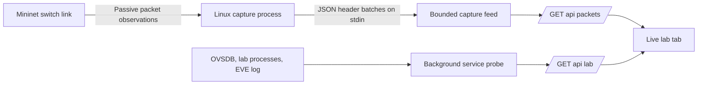

# ARCHITECTURE: AI-Driven SDN Threat Isolation

Reads: PRD.md, DESIGN.md. No application code. Design specification, not a deployed system.

## 1. Stack
| Layer | Choice | Reason |
|---|---|---|
| Data plane | Open vSwitch | Programmable forwarding and rule counters |
| Control plane | Ryu (OpenFlow) | Chosen in the PDF for the concrete control path (ONOS is mentioned only as an alternative) |
| Lab | Linux + Mininet | Matches the PDF's validation setup |
| Inline IPS | Suricata (inline, two interfaces) | Signature drops plus EVE events |
| Services | Python (alert listener, feature extractor, risk engine, logger, sealer, verifier) | Same language as Ryu *(assumption)* |
| Models | XGBoost, PyTorch Bi-LSTM, Isolation Forest (scikit-learn), SHAP | Benchmarked on DistriNet IEEE CNS 2022 dataset |
| Local store | SQLite durable spool + append-only events *(proposal)* | Simple, survives restarts, no extra server |
| Cloud | S3 Object Lock, CloudWatch Logs, SageMaker | From the PDF; never on the urgent path |
| Validation | Wireshark/TShark | Packet visibility in controlled tests |
| Optional | ClamAV | File-boundary scanning only |

## 2. Folder structure (proposed)
```
sdn-threat-isolation/
├── AGENTS.md  README.md  .env.example
├── backend/                 # Loopback API, SQLite reads, and live lab snapshots
├── frontend/                # Buildless HTML, CSS, and JavaScript operator console
├── docs/  (PRD DESIGN ARCHITECTURE DATABASE API PLAN SETUP FEATURES
│          AUTH_SECURITY MCP INTEGRATIONS TESTING DEBUGGING .md)
├── lab/
│   ├── packet_capture.py    # Passive headers and interval counters for one lab port
│   ├── topology/            # Mininet topology definitions
│   └── gateway/             # access policy (default deny, rate limits)
├── controller/
│   └── ryu_app/             # polling, FLOW_MOD, barrier/readback
├── sensors/
│   ├── suricata/            # config + rules (inline, EVE)
│   └── alert_listener/
├── risk/
│   └── policy_engine/
├── ai/
│   ├── features/            # feature contract + extractor
│   ├── models/              # xgboost, bilstm, iforest
│   └── explain/             # async SHAP/LIME worker
├── audit/
│   ├── logger/  sealer/  verifier/  spool/
├── cloud/                   # S3, CloudWatch, SageMaker wrappers
├── experiments/             # workloads, run configs, results
└── tests/
```

## 3. Data flow (four paths)
- **A Packet path:** client -> access gateway -> inline Suricata -> OVS -> protected server. Only this row carries user packets.
- **B Fast alert:** Suricata eve.json -> alert listener -> risk engine -> Ryu FLOW_MOD -> OVS.
- **C Behaviour:** OVS counters -> Ryu poll (2 s baseline) -> feature extractor -> models -> risk engine -> same Ryu/OVS response.
- **D Evidence:** events -> incident logger -> crypto sealer -> S3 Object Lock; sanitized summaries -> CloudWatch.
- **Model update (separate):** reviewed data -> SageMaker -> approved version -> local deploy/rollback.
- **Local console:** browser -> loopback Python backend -> read-only SQLite overview, live lab snapshots, or standalone flow inference. The console runs outside the Ryu process.

### Live lab observability



- Only the collector opens a packet socket. It checks that its selected port belongs to `s1`. The console consumes metadata through a local pipe and retains up to 60 intervals and 100 headers in memory.
- The collector measures elapsed time with a monotonic clock and numbers its reports. The chart uses those elapsed offsets for spacing, leaves gaps for missing reports, and uses wall-clock timestamps for labels. Kernel drops and omitted header rows are separate counts.
- The service API returns the latest observation while at most one background probe runs. Probe results record when they were checked. A detected process or connected controller establishes the stated observation. Dataplane reachability and inline behavior require the separate lab probes in [TESTING.md](TESTING.md#live-linux-lab).
- The Live lab page polls packet and service endpoints independently. Hiding the tab or leaving the page cancels its requests. Pausing the packet display leaves status checks and the collector running. There is no path from this view to enforcement or audit writes.

## 4. State and errors
- **State:** per-host/connection sample windows (feature service); per-action lifecycle `decision_created -> action_requested -> controller_accepted -> rule_processed/read_back -> data_plane_effect_observed -> action_expired_or_reverted`. Persist action IDs, cookies, expiry across restarts; reconcile against the switch.
- **Errors:** follow the failure table in section 7 of the PDF: explicit Suricata fail mode; never silent unrestricted forwarding on Ryu loss; AI unavailable is recorded as unavailable (no fake low-risk score); bounded queues with alerts; cloud loss never blocks local response.
- **Rules:** keep AI inference and cloud upload out of Ryu's event loop; give enforcement messages priority; deduplicate by stable ID.

## 5. Naming and style
snake_case for fields, files, tables; verbs for actions (`temporary_drop`); UTC ISO-8601 wall-clock timestamps plus monotonic durations; one module per service; type hints and docstrings *(assumption)*.

## 6. Environment variables
| Name | Purpose |
|---|---|
| `SDN_POLL_INTERVAL_S` | Baseline poll interval (default 2) |
| `SDN_POLL_INTERVAL_FAST_S` | Adaptive test interval (0.5) |
| `ACTION_DEFAULT_TTL_S` | Default hard timeout (60 = example policy, not an optimum) |
| `SURICATA_FAIL_MODE` | `closed` or `open`; **decision pending** |
| `EVE_JSON_PATH` | Path to eve.json |
| `RISK_ENGINE_URL` | Internal risk API on the management network |
| `SERVICE_TOKEN` | Service-to-service credential (placeholder) |
| `SPOOL_DIR` | Durable local queue |
| `AWS_REGION`, `EVIDENCE_BUCKET`, `CLOUDWATCH_LOG_GROUP` | Cloud targets |
| `SIGNING_KEY_ID`, `ENCRYPTION_KEY_ID` | References to protected keys (never key material) |

## 7. Scale and performance
requests/s = switches / interval. 100 switches: 50 req/s at 2 s, 200 req/s at 500 ms. Reply size can matter more than request count. 16 GB is RAM, not throughput; **no capacity figure has been measured**. Stagger polls, bound outstanding requests, back off on queue growth, decouple polling from inference.
