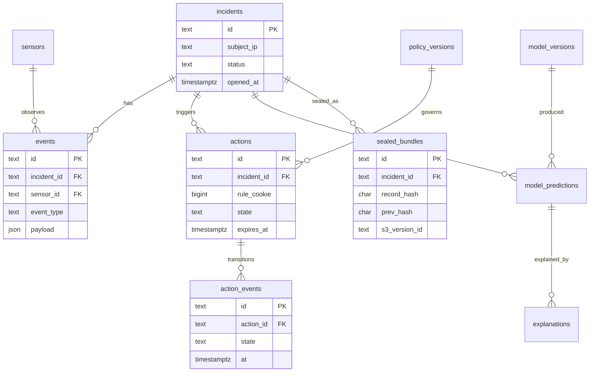

# DATABASE: Incident and Evidence Store

The PDF defines no database. This is a **proposed local durable store** (SQLite or PostgreSQL, team to choose) for the incident logger and spool, plus the sealed bundles in S3. Evidence rows are **append-only**: never rewrite an already sealed record; add a linked event. Soft delete therefore applies only to non-evidence reference tables.

## 1. Tables
All tables have `created_at` and `updated_at` (UTC, default now). IDs are text/UUID.

### sensors
| Column | Type | Notes |
|---|---|---|
| id | text PK | e.g. `ips-edge-1` |
| kind | text NOT NULL | CHECK in (`gateway`,`suricata`,`ovs`,`controller`) |
| switch_id, port | text | mapping to OVS attachment (nullable) |
| deleted_at | timestamptz | soft delete |

### policy_versions
| id PK | version text UNIQUE | description text | active bool default false |

### model_versions
| id PK | name text (`xgboost`,`bilstm`,`iforest`) | version text | approved bool default false | registry_ref text |
UNIQUE (name, version).

### incidents
| Column | Type | Notes |
|---|---|---|
| id | text PK | `incident_id` |
| subject_ip, target_ip | inet/text | subject must be validated, not assumed from `src_ip` |
| status | text NOT NULL | CHECK in (`open`,`contained`,`reverted`,`closed`) |
| opened_at | timestamptz NOT NULL | |

### events (append-only)
| Column | Type | Notes |
|---|---|---|
| id | text PK | `event_id` (stable for idempotent retry) |
| incident_id | text FK -> incidents.id | nullable until correlated |
| sensor_id | text FK -> sensors.id | observation point (avoid double counting) |
| event_type | text NOT NULL | `alert`,`suricata_drop`,`gateway_deny`,`decision_created`,`enforcement_requested`,... |
| source | text NOT NULL | e.g. `risk-policy-engine` |
| occurred_at | timestamptz NOT NULL | wall clock |
| duration_ns | bigint | monotonic measurement |
| payload | json NOT NULL | normalized event; original kept as evidence ref |
| evidence_ref | text | resolvable pointer to the source record |
| schema_version | int NOT NULL default 1 | |

### actions
| id PK (`action_id`) | incident_id FK | policy_version_id FK | switch_id | match json | action_type (`temporary_drop`,`rate_limit`,`quarantine`) | rule_cookie bigint | priority int | ttl_s int | expires_at | state text |
CHECK state in (`decision_created`,`action_requested`,`controller_accepted`,`rule_processed`,`effect_observed`,`expired`,`reverted`,`failed`,`rejected`).

### action_events
| id PK | action_id FK | state | at timestamptz | detail json |
One row per lifecycle transition (command handling and observed containment kept separate).

### model_predictions
| id PK | incident_id FK | model_version_id FK | feature_window json | score numeric NULL | label text NULL |
`score` stays NULL when no model produced one. Never invent a confidence.

### explanations
| id PK | prediction_id FK | method (`shap`,`lime`) | contributions json | computed_at |

### sealed_bundles
| id PK | incident_id FK | s3_bucket | s3_key | s3_version_id | record_hash char(64) | prev_hash char(64) | signature_alg | signing_key_id | enc_alg | nonce | tag | key_ref | verified_at NULL | verification_result text NULL |

### chain_checkpoints
| id PK | chain_id | head_hash char(64) | sequence bigint | anchored_to text | anchored_at |

## 2. Relationships
incidents 1-N events; incidents 1-N actions; actions 1-N action_events; incidents 1-N model_predictions; model_predictions 1-N explanations; incidents 1-N sealed_bundles; sensors 1-N events; policy_versions 1-N actions; model_versions 1-N model_predictions. No many-to-many.

## 3. Indexes
`events(incident_id, occurred_at)`; `events(event_type, occurred_at DESC)`; `actions(state, expires_at)` (expiry sweeper); `actions(rule_cookie)` (reconcile); `action_events(action_id, at)`; `sealed_bundles(incident_id)`; `incidents(status, opened_at DESC)`.

## 4. Access rules
Writers: logger service only (append-only grant on `events`, `action_events`). Risk engine writes `actions`. Operators read all; auditors read-only; nobody holds UPDATE/DELETE on `events`. Spool files readable by the service account only. If PostgreSQL: enforce with roles and row-level security.

## 5. Seed data
One incident `example-incident-001` (subject 192.0.2.10, target 198.51.100.20), one sensor `ips-edge-1`, event `example-suricata-event-001`, action `temporary_drop` with cookie 1 in state `action_requested`, `model_score` NULL. All values are the PDF's illustrative examples, not real evidence.

## 6. Migration order
1) sensors, policy_versions, model_versions 2) incidents 3) events 4) actions 5) action_events 6) model_predictions 7) explanations 8) sealed_bundles, chain_checkpoints 9) indexes 10) seed.
